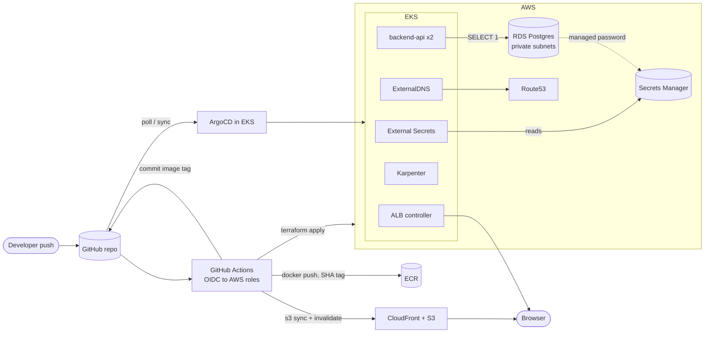

# Architecture

A two-replica Python API on EKS that runs `SELECT 1` against a private RDS Postgres
instance, plus a static frontend on S3 + CloudFront. Everything is provisioned by
Terraform and deployed by GitHub Actions and ArgoCD. After a one-time bootstrap, no
step depends on a local CLI run, and no long-lived AWS credentials exist anywhere.

> **Scope.** This is a code-only deliverable. Nothing has been applied to a live AWS
> account. Terraform is `fmt`/`validate`d, the Helm charts are linted and rendered,
> and the workflows pass `actionlint`, but none of it has run end to end.

## 1. Overview



**Request path.** The browser loads the site from `https://app.<domain>` (CloudFront, private
S3 origin via OAC). The page calls `https://api.<domain>/`, which resolves (ExternalDNS
record) to an internet-facing ALB (created by the ALB controller from the Ingress), which
forwards straight to pod IPs. Each pod runs `SELECT 1` and returns:

```json
{ "pod_name": "backend-api-79b88448f4-x8z2k", "db_status": "connected", "timestamp": "2026-10-12T09:44:00Z" }
```

If the database is unreachable the response is HTTP 503 with `"db_status": "error"`.

## 2. Repository layout

```
.github/workflows/
  terraform.yml      fmt/validate, PR plan, gated apply (infra, then platform layer)
  backend.yml        build image (Git SHA tag) -> ECR -> commit tag to gitops/
  frontend.yml       build -> S3 sync -> CloudFront invalidation
terraform/
  bootstrap/         ONE-TIME: state bucket, GitHub OIDC provider, CI roles
  envs/prod/         composition root: VPC, EKS, RDS, edge, observability, ECR, IRSA
  envs/prod-platform/ ArgoCD + root app-of-apps (separate state, see 4.3)
  modules/           vpc  eks  rds  irsa  acm  frontend  observability  ecr
gitops/
  platform/          app-of-apps chart: one ArgoCD Application per component
  charts/            karpenter-resources (NodePool/EC2NodeClass), external-secrets-config
  apps/backend/      Deployment, Service, Ingress, ExternalSecret, PDB
backend/             Flask + gunicorn service and Dockerfile
frontend/            static site + build.sh
```

## 3. Step-by-step instructions

### 3.1 One-time bootstrap (the only manual step)

GitHub Actions cannot assume a role that does not exist yet, so the OIDC provider, the CI
roles, and the state bucket must be created once by a human with admin credentials.

```bash
cd terraform/bootstrap
terraform init
terraform apply -var github_org=<org> -var github_repo=<repo> \
  -var github_owner_id=<owner-id> -var github_repo_id=<repo-id>
terraform output github_actions_variables
```

`github_owner_id` and `github_repo_id` are needed for repositories created after
2026-07-15, whose OIDC subject is `repo:<owner>@<owner_id>/<repo>@<repo_id>:...`
(`gh api repos/<owner>/<repo> --jq '.owner.id, .id'` prints them). The trust policies then
match those immutable IDs, which also survive a repo rename. Omit both for an older
repository that still uses `repo:<owner>/<repo>:...`.

Then move bootstrap's own state into the bucket it just created, so it is versioned,
encrypted and not tied to one laptop (the bucket has `prevent_destroy` set):

```bash
cp backend.tf.example backend.tf
terraform init -migrate-state \
  -backend-config="bucket=$(terraform output -raw state_bucket)" \
  -backend-config="region=<region>"
rm -f terraform.tfstate terraform.tfstate.backup   # local copies after migration
```

Commit `backend.tf`. Nothing else is ever run locally.

### 3.2 GitHub configuration

1. **Repository variables** (Settings > Secrets and variables > Actions > *Variables*).
   None are secrets, and **no repository secrets are used**:

   | Variable | Source |
   |---|---|
   | `AWS_ACCOUNT_ID`, `AWS_REGION`, `PROJECT_NAME`, `TF_STATE_BUCKET` | bootstrap output |
   | `DOMAIN_NAME` | an existing **public Route53 hosted zone**, e.g. `example.com` |
   | `ALERT_EMAIL` | where CloudWatch alarms are sent |

2. **Environment `prod`** (Settings > Environments): add required reviewers and restrict
   deployment branches to `main`. The apply role trusts exactly this environment's OIDC
   subject, so this is the approval gate for infrastructure changes.
3. The repository must be **public**, or ArgoCD needs a deploy key (see section 7).

### 3.3 First deployment

1. Merge to `main`. `terraform.yml` runs `validate`, waits for approval on `prod`, then
   applies `envs/prod` followed by `envs/prod-platform`.
2. ArgoCD (installed by the platform stack) syncs `gitops/platform`, which installs the
   ALB controller, ExternalDNS, External Secrets and Karpenter, then the resources that
   need their CRDs, then the backend.
3. The **first push also triggers `backend.yml` and `frontend.yml`, which fail** because
   the ECR repo and S3 bucket do not exist yet. Once the apply finishes, re-run both
   from the Actions tab (`workflow_dispatch`). From then on they run on their own paths.
4. Confirm the SNS subscription email (AWS sends a confirmation link).
5. Verify: `curl https://api.<domain>/` and open `https://app.<domain>`.

### 3.4 Day-to-day

| Change | What happens |
|---|---|
| Edit `terraform/**` in a PR | fmt + validate + plan, posted as a PR comment |
| Merge to `main` | gated apply of both Terraform stacks |
| Edit `backend/**` | image built and pushed, tag committed to `gitops/`, ArgoCD rolls it out |
| Edit `frontend/**` | build, sync to S3, CloudFront invalidated |
| Edit `gitops/**` | ArgoCD syncs it (automated, prune, self-heal) |

To reach the ArgoCD UI: `terraform output argocd_port_forward` in `envs/prod-platform`
prints the exact commands (no public ingress by default).

## 4. Design decisions and trade-offs

### 4.1 Networking
- Three AZs, three tiers per AZ: **public** (ALB, NAT), **private** (nodes, pods) and
  **database** (RDS only; no internet route).
- Subnets carry the ALB auto-discovery tags (`kubernetes.io/role/elb` on public,
  `kubernetes.io/role/internal-elb` on private) and `karpenter.sh/discovery` on private.
- **Trade-off:** `single_nat_gateway` defaults to `true` (one NAT, cheaper). That is a
  single-AZ dependency for outbound traffic; set it to `false` for one NAT per AZ.

### 4.2 Compute: Karpenter over Cluster Autoscaler
- A small managed node group (`system`, 2 x t3.medium) hosts Karpenter and core add-ons.
  Karpenter provisions everything else from a `NodePool`/`EC2NodeClass` kept in Git
  (spot + on-demand, c/m/r families, IMDSv2 only, encrypted gp3, CPU limit as a cost cap).
- Chosen over Cluster Autoscaler for faster, bin-packed, right-sized scaling with no
  per-ASG instance-type management.
- Kubernetes 1.35 (`eks_version`): in EKS standard support until March 2027, and
  supported by the pinned Karpenter 1.14.x (Karpenter 1.9+ supports 1.35).
- **Trade-off:** Karpenter needs its own bootstrap capacity (the system group) and an
  interruption queue. Both are provisioned.

### 4.3 Terraform and GitOps boundary
- Terraform owns AWS resources and installs exactly one thing in the cluster: ArgoCD plus
  a root Application. **Everything else is reconciled from Git.**
- The cluster and the Helm provider live in **separate states** (`envs/prod` and
  `envs/prod-platform`). A provider cannot be configured from a resource created in the
  same apply, and separate states also reduce blast radius.
- Account-specific values (role ARNs, queue name, DB host, hostnames) are Terraform
  outputs injected into the root Application's `helm.valuesObject`. They are **never
  committed to Git**, and the Git-held charts stay account-agnostic.
- Upstream chart versions are pinned in `gitops/platform/values.yaml`, so upgrades are
  reviewed Git changes. Sync waves order CRDs/controllers (0) before their resources (1)
  before the workload (2).
- **Trade-off:** ArgoCD pulls on a poll (about 3 minutes). A webhook would be faster but
  needs a stored secret, which conflicts with the zero-secrets policy.

### 4.4 Image delivery
- The backend pipeline commits the new tag into `gitops/apps/backend/values.yaml`. Git
  is the single source of truth for what runs, so rollback is `git revert`.
- ECR tags are **immutable** (Git SHA), images are scanned on push, and old images
  expire. A re-run for the same commit detects the existing tag instead of failing.
- **Trade-off:** the bot pushes straight to `main`. With branch protection this needs a
  bypass for the bot, or the step can be changed to open a PR.

### 4.5 Database
- RDS Postgres 17, Multi-AZ, encrypted, deletion-protected, in database subnets. The
  security group admits port 5432 **only from the EKS node security group**.
- The backend opens a short-lived connection per request. That keeps the health signal
  honest for a demo, and a pool would be the production choice.
- `/healthz` (used by probes and the ALB) deliberately does **not** touch the database,
  so a database blip does not cause the ALB to drain every pod. `GET /` is the check
  that reports database status.

### 4.6 Edge
- S3 is fully private; CloudFront reaches it via Origin Access Control and the bucket
  policy is scoped to that one distribution. TLS 1.2+, HTTP to HTTPS redirect, AWS-managed
  security-headers policy, Route53 A/AAAA aliases.
- The CloudFront certificate is in us-east-1 (an aliased provider). The ALB side
  discovers its ACM certificate by Ingress host, so no ARN is passed through Git.

### 4.7 Observability
- One SNS topic with an email subscription. Alarms: RDS CPU, free storage and connection
  count, and CloudFront 5xx rate.
- **Gap:** there are no ALB alarms. The ALB is created at runtime by the controller, so
  Terraform does not know its name.
- The topic is not encrypted with the AWS-managed key because CloudWatch alarms cannot
  publish to topics that use it.

## 5. Security decisions

| Area | Decision | Why |
|---|---|---|
| **CI auth** | Every workflow uses `aws-actions/configure-aws-credentials` with `role-to-assume` and `id-token: write`. No `AWS_ACCESS_KEY_ID` exists in the repo or in GitHub secrets. | No long-lived credentials to leak or rotate. |
| **CI roles** | Four roles, each with its own OIDC `sub` condition (and `aud = sts.amazonaws.com`): `tf-plan` (`pull_request`, read-only), `tf-apply` (`environment:prod`), `backend` (`main`, ECR push to one repo), `frontend` (`main`, one bucket + invalidations). | Least privilege per pipeline; PRs can plan but never apply or deploy. |
| **Apply role** | Has `AdministratorAccess`. | It creates IAM, EKS, VPC and more. Gated by the `prod` environment. A permissions boundary is the next hardening step. |
| **Plan role** | Read-only, **no Kubernetes access**. | Helm reads release state from cluster Secrets, so access would let any PR author read DB credentials. The platform stack is therefore planned only inside the gated apply job. |
| **IRSA** | One role per controller (ALB, ExternalDNS, External Secrets, Karpenter), each trusted by only its own service account. ExternalDNS is limited to the one hosted zone, and External Secrets to the one secret. | A compromised pod gets only its controller's permissions. IRSA was specified over Pod Identity. |
| **Secrets** | RDS manages the master password in Secrets Manager (`manage_master_user_password`). It never appears in Terraform config or state. External Secrets syncs it into a Kubernetes Secret. | No credential in Git, state or CI. Rotation is handled by RDS. |
| **Subnets / SGs** | DB subnets have no internet route. Only nodes can reach 5432. Nodes sit in private subnets behind NAT. | Database is unreachable from the internet and from anything but the cluster. |
| **Cluster access** | EKS access entries (no `aws-auth`). The apply role is cluster admin. | API-based, auditable access. |
| **Workloads** | Non-root, read-only root filesystem, all capabilities dropped, seccomp `RuntimeDefault`, IMDSv2 only on nodes, PDB, AZ spread. | Standard container hardening. |
| **Data at rest/in transit** | S3, RDS, EBS and state bucket encrypted. State bucket is versioned and public access is blocked. TLS enforced on S3 and the ALB. RDS requires SSL (`sslmode=require`). | |

## 6. Mapping to the assessment checklist

| Requirement | Where |
|---|---|
| No static AWS keys, OIDC everywhere | `.github/workflows/*.yml`, `terraform/bootstrap/main.tf` |
| Modular, validated Terraform | `terraform/modules/*`; `validate` + `fmt -check` in `terraform.yml` |
| Node autoscaling | Karpenter: `modules/eks`, `gitops/charts/karpenter-resources` |
| 100% automated lifecycle | the three workflows; bootstrap is the single documented exception |
| Backend: replicas > 1, `SELECT 1`, JSON | `gitops/apps/backend/values.yaml` (`replicaCount: 2`), `backend/app.py` |
| External Secrets, ExternalDNS, ALB Ingress | `gitops/platform/templates/*`, `gitops/apps/backend/templates/{externalsecret,ingress}.yaml` |
| Multi-AZ subnets with ALB tags | `terraform/modules/vpc/main.tf` |
| RDS private + Secrets Manager | `terraform/modules/rds/main.tf` |
| S3 + CloudFront + ACM + Route53 | `terraform/modules/{frontend,acm}` |
| CloudWatch alarms to SNS email | `terraform/modules/observability` |
| ArgoCD auto-sync from Git | `terraform/envs/prod-platform`, `syncPolicy.automated` in every Application |

## 7. Known gaps and next steps

- **Public repo assumed.** For a private repo, store a deploy key in Secrets Manager,
  sync it with External Secrets, and register it as an ArgoCD repository credential.
- **EKS public endpoint** is open to `0.0.0.0/0` by default so GitHub-hosted runners can
  reach it. Restrict `eks_public_access_cidrs` or use self-hosted runners inside the VPC.
- **Actions are pinned by major tag**, not commit SHA. Pin SHAs for production.
- **Unverified assumption:** the ExternalSecret references the RDS secret by ARN. If that
  does not resolve, switch `remoteRef.key` to the secret name.
- **Not included:** WAF, VPC flow logs, VPC endpoints, ALB alarms, tflint/checkov
  scanning, ArgoCD ingress/SSO, and a permissions boundary on the apply role.
